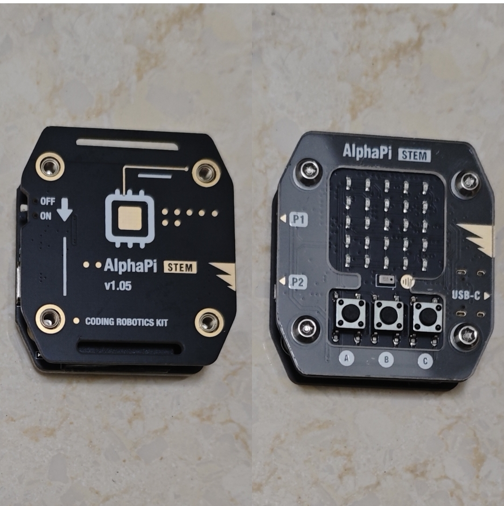

# AlphaPi STEM 小智语音助手 V2.4.13（正式版）



把 AlphaPi STEM 主板（ESP32-C3 / 4MB）变成**按键式**小智 AI 语音终端：按住 C 说话、松开等回复，
5×5 点阵显示状态；本地 / 官方服务器随时切换；配合「我的媒体库」还能语音点歌、听电台、听有声书。

| 项 | 值 |
|---|---|
| 版本 | **V2.4.13 r2**（2026-11-12 修订，正式版；补回配网门户「我的媒体库」设置页） |
| 主控 | ESP32-C3，4MB Flash，板上 N32 协控负责录音 / 播放 / 点阵 |
| 固件 | 单文件 `AlphaPi_Xiaozhi_V2.4.13.ino` |
| 编译尺寸 | 1,206,092 B（38%）/ 全局 RAM 95,692 B（29%） |
| 配套服务端 | `MyXiaoZhi_MediaServer` **≥ v1.6.8**（仅「我的媒体库」需要） |
| 刷机工具 | `AlphaPi_Xiaozhi_Flasher_V2.4.13.html`（Chrome / Edge 打开即用） |
| 项目地址 | https://github.com/shj4588/AlphaPi-STEM-XIAOZHI |

> 本文是**使用说明**：怎么装、怎么用、能说什么。开发期的排障复盘、协控协议实验记录不在此文件，
> 需要时查源码注释与历史版本目录。

---

## 一、刷机

### 1. 网页刷机（推荐）

双击 **`AlphaPi_Xiaozhi_Flasher_V2.4.13.html`**，用 **Chrome / Edge** 打开（Web Serial）：

1. USB 数据线接主板到电脑（插 USB 即可供电）；**一次只接一块板**，One 与 STEM 的 VID/PID 相同，同时插会认错串口。
2. 点「连接串口」选 COM 口，波特率固定 **115200**（C3 不要改）。
3. 建议先点「开始备份固件」保存原机整片 4MB Flash。
4. 选模式 → 点「开始烧录」→ 等日志出现「烧录完成」再拔线。失败时**重新插拔 USB 后原样重试**，不用按 BOOT。

| 模式 | 写入 | 效果 |
|---|---|---|
| **分文件烧录（推荐升级）** | 引导 `0x000000` / 分区表 `0x008000` / boot_app0 `0x00E000` / 主程序 `0x010000` | **保留 NVS**：WiFi、服务器、激活状态、媒体库配置都不丢 |
| **完整固件（单文件）** | 4MB 全量镜像 @ `0x0`，先擦除整片 | 配置全清，全新设备或配置乱了时用 |

- 分文件模式另有「烧录前擦除整片 Flash」勾选项（默认不勾），勾上等价于全新设备。
- 刷机页内嵌的固件与本目录 `bin/` 完全一致，逐字节校验过；首次打开需联网加载 esptool-js（CDN）。
- 页面里的「适配声明」照片就是这块板（正面 5×5 点阵 + A/B/C 键 + USB-C，背面印 `AlphaPi STEM v1.05`），**其它型号不要刷**。

### 2. Arduino 手工编译（可选）

| 项 | 值 |
|---|---|
| ESP32 core | **2.0.14**（不要升 3.x） |
| 库 | `WebSockets` 2.7.2、`arduino-libopus` 1.3.2 |
| 板型 | `ESP32C3 Dev Module` / Flash 4MB / Partition `Huge APP (3MB No OTA)` / Upload 115200 |

```bash
arduino-cli compile --fqbn "esp32:esp32:esp32c3:FlashSize=4M,PartitionScheme=huge_app" <sketch目录>
```

> 链接报 libopus 未定义符号时，用 `--build-path <全新目录>` 重编（旧缓存残缺）。

---

## 二、配网与首次使用

1. 上电后 **长按 A 键 2 秒**打开配网门户（连不上 WiFi / 未激活 / 全新设备时会自动打开）。
2. 手机连开放热点 `AlphaPi-XZ-xxxx` → 访问 **http://192.168.4.1/**。
3. 填 WiFi → 保存重启；再选服务器：
   - **本地服务器**：`ws://<IP>:8000/xiaozhi/v1/`，填 host / port / path / token，**免激活**。
   - **官方服务器**：点「获取激活码」→ 去 xiaozhi.me 添加设备输码 → 再点一次完成激活。
4. 要用「我的媒体库」：在门户的**「我的媒体库（自建曲库）」**区块里填 NAS 的 IP（端口默认 **8100**），勾选启用并保存（**即时生效、不重启**），然后说一句「启用我的媒体库」。
   - 该区块会显示**实际生效**的曲库地址；**连官方服务器时必填**，否则地址为空、媒体库不可用。
   - **连本地小智服务器时留空即可**：设备会自动沿用那台服务器的 host + `:8100`。
   - 关闭开关会立刻停掉正在播的本地流；配置写入 NVS，刷机不擦 NVS 就不会丢。
5. 按住 **C** 说话，松开等回复；换 WiFi / 换服务器随时长按 A 开门户。配网门户开着也能正常说话（AP+STA 共存）。

> ESP32 烧录默认**不擦 NVS**。全新设备若刷完显示「已激活」但连不上，串口发 `F` 恢复出厂（清空 WiFi / 服务器 / 激活全部配置并重启），或勾选刷机页的「擦除整片 Flash」。

---

## 三、按键、屏幕与休眠

| 操作 | 动作 |
|---|---|
| **按住 C** | 开始说话（`listen start`），松开结束录音、等 TTS |
| **短按 C**（待机 / 云端播放） | 打断当前播放；显示失望脸 |
| **短按 C**（有声书播放中） | **暂停**：停推流 + 上报位置 + 显示暂停图案；再短按从暂停点继续 |
| **长按 C**（≥700ms，有声书播放中） | 先暂停并上报位置，再开口说话 |
| **单击 A / B** | 音量 −1 / +1 档（共 6 档），点阵显示实心三角柱状图 1.2s；播放中也能调 |
| **长按 A（2s）** | 开 / 关配网门户 |
| **长按 C（深睡中）** | 唤醒（整机复位）并直接开始对话 |

播放图案（5×5）：**音乐 = 音符**、**有声书 = 摊开的书**、**电台 = 收音机**、**暂停 = 两条竖杠**。
播放期间云端下发的笑脸 / 情绪脸**不会顶掉**播放图标。

- **60 秒无操作深度休眠**：点阵闪 2 次大 X → 断 WS → µA 级深睡；录音、播放、门户开着、调音量都不睡。
- **播完那一集才重新数 60 秒**（播放期间持续刷新空闲基准），不会一听完就立刻睡。
- 音量 **3 档**受协控 N32 增益表 bug 影响会破音，日常建议用 2 / 4 / 5 / 6 档。

---

## 四、小智 MCP 工具（语音指令详解）

### 4.1 工作方式

固件在 hello 里声明 `features.mcp=true`（媒体库启用时），服务器连上后做
`initialize` → `tools/list` → `tools/call` 握手，把**设备侧 9 个工具**登记进云端 LLM 的工具表。
用户说话由云端判断意图并回调设备，**音频由设备自己从 NAS 取**（8bit / 24000Hz / 单声道裸 PCM，
24KB/s），不经云端音乐插件、零解码零重采样。

- 工具返回文本由 `result.content[0].text` 回给 LLM，小智会据此组织口语回复；**不用记工具名，直接说话**。
- 前置校验：媒体库未启用 → 提示先启用；地址没配 → 提示去门户填 NAS IP，绝不谎报「已播放」。
- **MCP 与 STT 兜底互斥**：只有服务器没做 MCP 握手时，才由本机关键字兜底（只认开关点歌 + 中文数字进度口令）。
- 点播时工具一回就抢跑取流，但**等小智那句确认语说完才起播**；没有确认语时 0.5s 内出声，不吞第一个字。

### 4.2 工具总表

| # | 工具 | 参数 | 典型说法 | 作用 |
|---|---|---|---|---|
| 1 | `self.stem.media_library` | `on`（布尔，省略=查询） | 「启用 / 关闭我的媒体库」 | 开关自建曲库；关闭时立即停播 |
| 2 | `self.stem.play_song` | `keyword`（必填，歌名 / 歌手） | 「播放晴天」「来点周杰伦」 | 自建曲库**歌单连播** |
| 3 | `self.stem.play_radio` | `name`（必填，台名） | 「放中国之声」「听广播」 | 打开网络电台（直播无限流） |
| 4 | `self.stem.play_book` | `keyword`（必填，书名）、`episode`（可省） | 「听凡人修仙传」「放三体第 3 集」 | 打开有声书；省略集号 = **从上次位置续播** |
| 5 | `self.stem.next_play` | 无 | 「下一首」「下一集」「换一个」 | 跳到歌单下一首 / 有声书下一集 |
| 6 | `self.stem.current_play` | 无 | 「现在放的是什么」「这集多长」「还剩多久」 | 查曲目信息与进度 |
| 7 | `self.stem.seek_play` | `sec`（绝对秒）/ `delta`（相对秒） | 「跳到第十二分钟」「快进 30 秒」「后退五分钟」 | 调整有声书进度；都不传 = 只查进度 |
| 8 | `self.stem.signal_status` | 无 | 「信号好不好」「怎么老卡」 | 报 WiFi RSSI / 信号分档 / 卡顿建议 |
| 9 | `self.stem.stop_play` | 无 | 「停」「别放了」「安静」 | 停止播放并收场 |

### 4.3 逐工具说明

**① `media_library`** — 传 `on=true` 启用（之后点歌默认走自建库），`false` 关闭（点歌交还云端，且**立刻停掉正在播的本地流**）；不传参数只查询当前开关。回「我的媒体库已启用 / 已关闭」。

**② `play_song`** — `keyword` 传歌名或歌手原句，服务端搜索后把一批歌 concat 成一条流连续播（默认 6 首）。回「已从自建曲库取「××」，马上播放」。**不要用云端音乐搜索**。

**③ `play_radio`** — `name` 传台名（如「中国之声」），不必给网址。电台是**直播流、永不 EOF**，本地场次硬顶临时放宽到 1 小时；没有「下一首」，也**不能调进度**。

**④ `play_book`** — `keyword` 传书名；`episode` 传集号，省略则 `ep=0` 由服务端查这台设备上这本书的**上次那集 + 位置前 10 秒**起播。回「正在打开《××》第 N 集」或「正在从上次听到的位置打开《××》」。

**⑤ `next_play`** — 歌单按响应头 `X-Track-Count`（本条流实际首数）跳下一首；有声书跳下一集。电台调用会回「电台是直播流，没有下一首」。一集**真播完**（服务端 EOF）不用说话，自动接下一集；全书最后一集安静收场。

**⑥ `current_play`** — 返回「正在播放歌曲 / 有声书 / 电台：「标题」」：
- 歌曲 = `歌名 - 歌手`；电台 = 台名；有声书 = `书名 · 演播 · 第 N 集`，并附 **总时长 / 已播到 / 还剩**（暂停时标「已暂停」）。
- 标题来自服务端响应头 `X-Media-Title`；位置口径 = 起点（`X-Resume-Offset` 或 `ss`）+ 单调累计的实播秒数，断电心跳 / 暂停 / 播完都不会倒退。

**⑦ `seek_play`** — 见 4.4。

**⑧ `signal_status`** — 返回 `WiFi 信号 -xx dBm，很好（满格）/ 良好（3 格）/ 一般（2 格）/ 较差（1 格），已连接「SSID」` + 结论：
`≥ -60` 信号充足、卡顿基本与 WiFi 无关；`-60 ~ -70` 基本稳定、偶发卡顿多来自服务端；`< -70` 信号偏弱，建议靠近路由器 / 避开金属遮挡 / 换 2.4G 信道。WiFi 未连接时直接答「设备当前离线」。

**⑨ `stop_play`** — 停止播放、断开取流、必要时中断云端 TTS，回「已停止播放」。按 C 暂停 / 说停 / 切歌都会取消待办的自动续集。

### 4.4 `seek_play` 进度控制细节

| 参数 | 含义 | 例子 |
|---|---|---|
| `sec` | **绝对秒**（集内位置） | 「跳到第 760 秒」「从第 12 分钟开始播」→ `sec=760` / `720` |
| `delta` | **相对秒**，正数快进、负数后退 | 「快进 30 秒」→ `delta=30`；「后退五分钟」→ `delta=-300` |
| 都不传 | 只查询，不跳转 | 回「已播到 X 分 Y 秒，本集共 …，还剩 …」 |

- 实现是**同一集带 `&ss=<目标秒>` 原地重开一条流**（服务端输入侧 `-ss`），不是本地快放。
- 目标夹在 `[0, 本集时长 − 3 秒]`，避免 `-ss` 越界导致 ffmpeg 零字节（旧版曾听到「嘀」一声就没声）。
- 只对**有声书**有效：电台是直播流，歌单请说「下一首」。
- 中文数字（五 / 十 / 二十五 / 两 / 一百二十）与「秒 / 分钟 / 小时」由云端换算成秒；STT 兜底路径本机也能解析。

### 4.5 语音指令速查

| 想做什么 | 直接说 |
|---|---|
| 开关曲库 | 「启用我的媒体库」「关闭曲库」 |
| 听歌 | 「播放晴天」「来点周杰伦的歌」 |
| 听电台 | 「放中国之声」「听新闻台」 |
| 听书 / 跳集 | 「听凡人修仙传」「放三体第 3 集」 |
| 换一个 | 「下一首」「下一集」「跳过这首」 |
| 查内容 | 「现在放的是什么」「这集多长」「播到哪了」「还剩多久」 |
| 调进度 | 「跳到第十二分钟」「快进 30 秒」「后退五分钟」 |
| 查信号 | 「信号好不好」「网络怎么样」「怎么老卡」 |
| 停 | 「停」「别放了」「关掉音乐」 |

---

## 五、我的媒体库：播放、记录与续播

> 需要 NAS 上的 `MyXiaoZhi_MediaServer` **v1.6.8+**（`/ap/play`、`/ap/pos`、`/api/history`、ffmpeg 转码）。

- **音频格式唯一可用**：8bit / 24000Hz / 单声道裸 PCM（24KB/s）。设备把 HTTP socket 的字节直塞播放 FIFO，队列由服务端 ffmpeg concat 完成，设备端零队列、零重采样。
- **播放记录存在 NAS**（`files/history.json`），按请求头 `X-Dev-Mac` **分设备记账**，媒体库 Web 第三个 tab「播放记录」可查看 / 删除。断电兜底：播放中每 **30 秒**上报一次心跳位置（`beat=1`），意外断电最坏只丢 30 秒。
- **只有有声书续播**：说「听××书」→ 服务端查这台设备这本书的最后记录 → 从**位置前 10 秒**起播；歌曲（歌单连播）与电台不续。位置只认设备上报的集内绝对秒（`abs`），「这集播完」只认设备 `fin=1`。
- **一集播完自动接下一集**：判据是服务端 EOF，等到 FIFO 播空再重连；按 C 暂停、说停、电台都不会自动续。播完那一刻才重新计 60 秒空闲。
- **有声书按 C 暂停 / 恢复**：暂停会断 socket、立即静音、**上报位置**（服务端立即停转码）；再短按带 `ep & ss` 原地恢复。音乐 / 电台按 C 仍是打断说话。
- 断流（网络抖动）时不报「播完」，2 秒后在断点原地续播；集尾一律按本集播完收场，不会倒回重播。

---

## 六、串口命令与排障

串口 **115200 8N1**；应用运行期 USB-Serial-JTAG 能正常收日志（抓日志时把 `dtr`/`rts` 置 `False`，否则 RTS 会按住 EN）。

| 命令 | 作用 | 命令 | 作用 |
|---|---|---|---|
| `i` | 打印当前服务器信息 | `m` | 媒体库状态 / 当前播放 |
| `o` / `l` | 切官方 / 本地服务器 | `a` | 联网核对激活状态 |
| `w` | 开 / 关配网门户 | `r` | 重连 WebSocket |
| `s` | 紧急停止播放 | `F` | 恢复出厂（清配置并重启） |

常见日志前缀：`[WS]` 连接 / `[MCP]` 工具调用 / `[LIB]` 媒体库 / `[DL]` 下行播放 / `[WiFi]` / `[CFG]` 门户 / `[MEM]` 堆水位。

| 现象 | 先看哪里 |
|---|---|
| 连不上服务器 | 门户 `192.168.4.1` 核对 WiFi / 服务器地址；串口 `i` |
| 点歌说「已播放」却没声 | 「启用我的媒体库」+ 门户填 NAS IP（默认 8100）；串口看 `[LIB] 未配置媒体库地址` |
| 只有 `[LIB]` 没有 `[MCP]` | 服务器没做 MCP 握手，落在 STT 关键字兜底（只认开关点歌与进度口令） |
| 听书偶有卡顿 | 说「信号好不好」；本地流的断粮日志看 socket 可读字节 / 距上次收字节 / FIFO / RSSI，**别用 WS/pong 口径判本地流** |
| 一集播完没接下一集 | 看串口 `[LIB] 断流对账 … atTail / cutShort`；确认服务端是 v1.6.8（夹值 `dur-3`） |
| 刷完显示「已激活」但不可用 | 串口 `F` 恢复出厂，或刷机页勾选「擦除整片」 |
| 烧录连不上芯片 | 重新插拔 USB 后原样重试；C3 只认 115200，别按 BOOT、别改波特率 |

---

## 七、已知限制

- **音量 3 档破音**：协控 N32 增益表缺陷（硬件问题），建议避开该档，其它档正常。
- **无唤醒词**：纯按键触发，不常驻监听。
- **媒体库音频只支持 8bit / 24k / 单声道**：抖动补偿、噪声整形、16bit、软件增益等均已实机证伪，别再试。
- **刷机页需 Chrome / Edge + 首次联网**（esptool-js 走 CDN）；固件本身离线可用。
- 官方服务器约 80 秒踢掉空闲 WebSocket，**本地播放中 WS 断开是正常现象**，不代表流断了。

---

## 八、近期版本

| 版本 | 要点 |
|---|---|
| **V2.4.13 r2** | 补回 V2.4.0 重构门户时误删的「我的媒体库（自建曲库）」设置页（显示实际生效地址、开关 / 改 IP 端口、`/savemlib` 即时生效不重启）；固件号仍为 `V2.4.13`，编译尺寸 1,206,092 B。与首版 V2.4.13 的区别只在这一项 |
| **V2.4.13** | 修「跳到集尾不接下一集、倒回 28 秒重播本集」：`MS2B` 单位改对（15s/30s）、集尾 `atTail` 短路、断点夹 `dur-3`；配套服务端 v1.6.8 |
| V2.4.12 | 新增 `seek_play` 语音调进度、`signal_status` 读信号；`current_play` 答总时长 / 已播到 / 还剩；工具增至 9 个 |
| V2.4.11 | 位置单调累计 `mLibAckBase`、本地流禁「饿透重推头」、FIFO 20KB→32KB、集尾位置取时长；服务端 v1.6.6 paced 发送 |
| V2.4.10 | 断流原地续播（`X-Book-Dur` 对账）、`current_play` 读曲名 / 书名 / 台名 |
| V2.4.9 / 8 / 7 | 30s 位置心跳；确认语说完才起播（无确认语 0.5s 出声）；播放图标不被云端笑脸顶掉 |
| V2.4.5 ~ 4.2 | 一集播完自动续集、播完重计空闲；听书按 C 暂停 + 三种图案；播放记录按 MAC 分设备、有声书续播；本地流不再被云端判据判死 |
| V2.4.0 / 2.3.2 | 设备侧 MCP + 我的媒体库；60 秒深度休眠、长按 C 唤醒直接对话 |

> 更早版本（V2.2.x 吞字修复、V2.1.x 下行定责、V2.0.x 配网门户）见源码注释与历史版本目录。

---

## 九、发布包内容

| 文件 | 说明 |
|---|---|
| `README.md` | 本文 |
| `AlphaPi_Xiaozhi_V2.4.13.ino` | 固件源码（单文件） |
| `AlphaPi_Xiaozhi_Flasher_V2.4.13.html` | 自包含网页刷机工具（内嵌固件 + 4MB 全量镜像、备份、适配照片、语音指令速查） |
| `bin/` | 编译产物：主程序 / bootloader / partitions / boot_app0 / elf / map |
| `AlphaPi_Stem（Zero）.jpg` | STEM 主板正反面照片（刷机页适配声明用） |
| `.build/` | arduino-cli 构建缓存（可删） |
